# 03 — Silicon Cryptographic Boundary & Clean-Room Software Split

## 1. Where NVIDIA Signature Enforcement Actually Lives

A common misconception is that host x86 obfuscation hides secret driver paths inside `nvidia.ko`. Decompiling `p4_focus.o` and `p4_sig_focus.o` with Ghidra `12.1.4` establishes the opposite: **the cryptographic root of trust resides inside the GPU hardware's Falcon BootROM (BROM) and hardware fuses**, not inside x86 driver code.

### Observed Host Sequence Before/During Falcon Signature Checks

1. **`PrivSec` hardware gate (`_nv030951rm`)**: Host RM queries the hardware `PrivSec` predicate (`0xff000020 == 1` in RM helper context) and device PMU/fuse fields (`FUN_00104034`). If `PrivSec` is not enabled on fused silicon, HS/LS privilege workflows refuse to proceed.
2. **Production vs. Debug fuse detection (`FUN_00104034`, `_nv016905rm`)**: The host reads Falcon security/fuse state (`0x10a000` family / engine devinfo bits shifted by `0x1c` and `0x1e`) solely to choose which *already-signed* signature blob from `BindataStorage` to copy into DMEM:
   - Production-fused silicon -> selects `id=0x3d` (`16`-byte PROD HS signature)
   - Unfused/Debug silicon -> selects `id=0x39` (`16`-byte DBG HS signature)
3. **In-memory DMEM patching (`_nv016905rm`)**: RM never computes a cryptographic signature on the host. It copies the chosen 16-byte pre-signed blob to `dmem + patch_loc` (`patch_loc = 0x3a20` in `gp104_acr_load/id_0x3b.bin`) prior to triggering Falcon execution.
4. **Heavy-Secure (HS) ACR bootstrap & `WPR1` lock (`_nv028571rm`, `_nv028391rm`, `_nv016731rm`, `_nv044785rm`)**:
   - Host allocates/configures Write-Protected Region 1 (`WPR1`) metadata headers (`LsfWprHeader` / `LsfLsbHeader`), stages LS Falcon images (`PMU=0`, `FECS=2`, `GPCCS=3`, `NVENC=4`, `NVDEC=5`, `SEC2=7`) alongside their `192`-byte NVIDIA LS signatures (`0x2dac0` PMU, `0x29f80` NVENC, etc.), and programs MMIO window `NV_PFB_PRI_MMU_WPR_INFO` (`0x0010_0e00`).
   - Host uploads HS `ACR_BL` + `ACR_LOAD` into Falcon SRAM/FB DMA, writes `BOOTVEC`, and sets `CPUCTL.STARTCPU` (`0x10a100` / `0x087100`).
   - GPU BROM verifies the HS signature in hardware (`BROM` signature check). Only verified HS ACR gains hardware privilege to lock `WPR1` in MMU registers and cryptographically validate each `192`-byte LS signature before unhalting LS Falcons.
5. **Hardware rejection path (`_nv016743rm`)**: If an HS or LS blob fails silicon BROM verification (modified code, wrong chip, or PROD/DBG fuse mismatch), the GPU returns error code `0x4f` in Falcon `MAILBOX0` / RPC status and blocks privileged VRAM (`WPR1`) access. Once HS ACR validates LS PMU/SEC2, RM talks to the booted engines via command/RPC IDs (`0xa00` PMU, `0x1807`/`0x280f` SEC2).

- **LS Falcon Engine IDs (`_nv029066rm` / LSF footer)**: `0 = PMU`, `2 = FECS`, `3 = GPCCS`, `4 = NVENC`, `5 = NVDEC`, `7 = SEC2`.

## 2. Live Silicon Proof: Why Falcon Signature Enforcement Cannot Be Bypassed in Software

Sampling physical BAR0 registers via [`p4_cleanroom_diag.c`](file:///c:/Users/Sanjay/Documents/AI%20Projects/p4/kmods/p4_cleanroom_diag/p4_cleanroom_diag.c) across three driver states on the live Tesla P4 (`0000:01:00.0`) proves directly on silicon why unsigned software cannot bypass Falcon:

| Register / State | Unbound (`no_driver`) | `nouveau 1.4.2` | Live R580 (`580.178.04`) | Hardware Enforcement Verdict |
| :--- | :--- | :--- | :--- | :--- |
| **`NV_FUSE[0x21000, 0x21400]`** | `c0040000 00000001` | `c0040000 00000001` | `c0040000 00000001` | `PrivSec` fused ON permanently (`bit 0 = 1`) |
| **`NV_PFB_WPR_INFO` / `0x100e40..50`** | `0xbadf5040` | `0xbadf5040` | Privileged WPR active | `PRIV_LEVEL_MASK` rejects Level-0 host CPU access |
| **`PCIe LnkSta`** | `lnk_speed=1` (`2.5 GT/s`) | `lnk_speed=1` (`2.5 GT/s`) | **`lnk_speed=3` (`8.0 GT/s`)** | Full Gen 3 x16 requires authenticated PMU init |
| **`PMU` (`0x10a000`) `cpuctl` / `sctl` / `bootvec`** | `0x10` / `0x3000` / `0x0` | `0x20` / `0x3002` / `0x0` | **`0x60` / `0x7021` / `0x5e00`** | Stays unauthenticated (`pstate: ENODEV`) without LS `0x2dac0` + `300,288`B RTOS |
| **`SEC2` (`0x087000`) `cpuctl` / `sctl` / `bootvec`** | `0x10` / `0x3000` / `0x0` | `0x60` / `0x7021` / `0xfd00` | **`0x60` / `0x7021` / `0xfd00`** | LS Mode `0x7021` active only after signed ACR load |
| **`FECS` (`0x409000`) `cpuctl` / `sctl` / `bootvec`** | `0x10` / `0x3000` / `0x0` | `0x10` / `0x3000` / `0x0` | **`0x60` / `0x7021` / `0x5e00`** | GR/CUDA engines locked until FECS LS authenticated |
| **`GPCCS` (`0x41a000`) `cpuctl` / `sctl`** | `0x10` / `0x3000` | `0x10` / `0x3000` | **`0x60` / `0x7021`** | GPCCS enters LS Mode `0x7021` only under valid ACR/LS |

Because retail `GP104` fuses enforce `PrivSec = 1`, `WPR` control (`0xbadf5040`), and hardware `SCTL` (`0x3000 -> 0x7021`) inside Falcon BROM, **software cannot forge or skip Falcon signatures**. Signed blobs in [`firmware-blobs/`](../firmware-blobs/README.md) must accompany any full-feature driver.

## 3. Clean-Room Boundary Diagram

```mermaid
flowchart LR
    subgraph HostOpen["Open-Source Clean-Room Host Driver (GPLv2 / MIT)"]
        A["1. PCI/BAR0 Probe (BOOT_0 / BOOT_42 -> GP104 0x134)"]
        B["2. VBIOS BIT / DEVINIT Verify & SysmemFlush"]
        C["3. Read PrivSec & PROD/DBG Fuse State"]
        D["4. Select Pre-Signed Blob + Patch DMEM @ patch_loc"]
        E["5. Carve WPR1 + Write LsfWprHeader/LSB + Stage LS Blobs"]
        F["6. Load IMEM/DMEM via PIO/DMA & Start Falcon CPUCTL"]
    end

    subgraph SiliconGate["Immutable Hardware Trust Boundary (GP104 Silicon)"]
        G["Falcon BROM Verifies 16B HS Signature -> Fails w/ 0x4f"]
        H["HS ACR Locks WPR1 (0x100e00) & Verifies 192B LS Signatures"]
        I["Privileged LS PMU / SEC2 / FECS / GPCCS / NVDEC Execute"]
    end

    A --> B --> C --> D --> E --> F --> G --> H --> I
```

## 3. What Remains Signed Binary vs. Clean-Room Open Code

| Component | Can Be Clean-Room Open Source? | Why | Deliverable in This Repo |
| :--- | :--- | :--- | :--- |
| Host PCI probe, BAR0 MMIO, `SysmemFlush`, `FbLayout`, `Vbios` `BIT` parser | **Yes (100% Open)** | Standard MMIO register & PCI ROM parsing | [`nova-pascal/src/{gpu,fb,vbios}.rs`](file:///c:/Users/Sanjay/Documents/AI%20Projects/p4/nova-pascal/src/gpu.rs) |
| Falcon PIO SRAM uploader, DMA/scrub state machine, `BOOTVEC`/`CPUCTL`/`MAILBOX0` polling | **Yes (100% Open)** | Pure host MMIO protocol; `GP104` register layout documented | [`nova-pascal/src/{falcon,acr,boot}.rs`](file:///c:/Users/Sanjay/Documents/AI%20Projects/p4/nova-pascal/src/falcon.rs) |
| `.rodata` `BindataStorage` parser & blob extractor | **Yes (100% Open)** | Parses standard ELF + raw DEFLATE tables cleanly | [`tools/nv_bindata_analyzer.py`](file:///c:/Users/Sanjay/Documents/AI%20Projects/p4/tools/nv_bindata_analyzer.py) |
| Linux `7.0+` OS/DRM/UVM kernel shim (`nv-interface.o`, `nvidia-drm.ko`, `nvidia-uvm.ko`) | **Already Open (`MIT` / `Dual MIT/GPL`)** | All Linux kernel API glue lives outside `nv-kernel.o_binary` | [`dkms-compat/`](file:///c:/Users/Sanjay/Documents/AI%20Projects/p4/dkms-compat/r580-linux-7x-compat-matrix.md) |
| Read-only `GP104` PCI/BAR0/Falcon telemetry kernel driver | **Yes (`GPL-2.0`)** | Zero NVIDIA headers or blobs required | [`kmods/p4_cleanroom_diag/`](file:///c:/Users/Sanjay/Documents/AI%20Projects/p4/kmods/p4_cleanroom_diag/p4_cleanroom_diag.c) |
| HS `ACR_BL`, `ACR_LOAD`, `ACR_UNLOAD`, `SEC2_HS`, LS `PMU_RTOS`, `SEC2_RTOS`, `FECS`, `GPCCS`, `NVDEC` + HS/LS signatures | **No (Must remain redistributable NVIDIA-signed firmware blobs)** | GP104 BROM hardware checks RSA/AES signatures fused to NVIDIA private keys; unsigned binaries are rejected with `0x4f` | Extracted from `580.178.04` on disk as read-only firmware assets |

